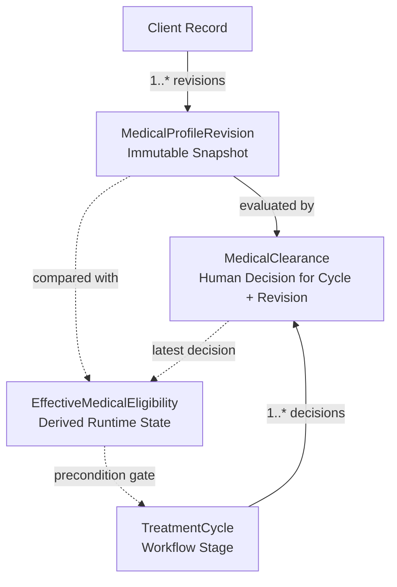

# Requirements

### Overview & Goals
Establish the corrected semantic architecture for **Medical Clearance V2**, decoupling immutable client medical evidence snapshots (`MedicalProfileRevision`), specialist clinical decisions (`MedicalClearance`), runtime clinical eligibility (`EffectiveMedicalEligibility`), and workflow state machines (`TreatmentCycle.stage`).

### Scope
- **In Scope**:
  - Semantic classification of client medical profile fields into `ALWAYS_REVIEW`, `ZONE_OR_CONTEXT_DEPENDENT`, and `NON_CLEARANCE_METADATA`.
  - Specification of `REVIEW_REQUIRED` as a pure derived runtime state (`EffectiveMedicalEligibility`) rather than a synthetic persisted decision row.
  - Strict preservation of workflow stage separation: medical clearance status changes never silently mutate `treatment_cycles.stage`.
  - Non-destructive legacy data reconciliation contract: legacy `cycleQualifications` rows remain historical evidence and are not asserted as modern `CLEARED` records for unreviewed medical revisions.
  - Phased implementation roadmap for Phase 3.1B.
- **Out of Scope**:
  - Database schema modifications or DDL execution in this phase.
  - Automated or implicit workflow stage mutations upon medical edits.
  - Direct implementation of future Procedure, Calendar, or Ledger commands.

### User Stories
- **As a Specialist**, I want to see the exact immutable medical profile revision that was present when I cleared a treatment cycle, so that clinical auditability is guaranteed.
- **As a Specialist**, I want new medical contraindications (such as pregnancy or anticoagulant therapy) to automatically flag active cycles as `REVIEW_REQUIRED` without silently advancing or canceling the treatment cycle stage.
- **As an Administrator**, I want ordinary administrative updates (such as client phone or address changes) to never reset or invalidate clinical medical clearance.

### Functional Requirements
1. **Medical Profile Revisions**:
   - Any edit to clinically significant medical profile fields creates a new append-only `MedicalProfileRevision` with an incremented revision number and actor attribution.
   - Administrative client edits produce 0 medical revisions and 0 clearance invalidations.
2. **Medical Clearance**:
   - Specialists record explicit clinical decisions (`CLEARED`, `CONSULTATION_REQUIRED`, `NOT_CLEARED`) scoped to a specific `(cycleId, medicalRevisionId)` tuple.
3. **Effective Medical Eligibility**:
   - Computed dynamically per cycle: resolves to `CLEARED` only if the cycle has a clearance record matching the client's latest medical revision.
   - If latest revision is unreviewed, eligibility resolves to `REVIEW_REQUIRED` without writing synthetic database rows.
4. **Workflow Invariance**:
   - Medical clearance decisions act as precondition gates on domain commands but never directly mutate `treatment_cycles.stage`.

# Technical Design

### Current State & Deficiencies
- `clientMedicalProfiles` is mutated in place without explicit revision numbering or author tracking.
- `cycleQualifications` captures procedural history risks (e.g., 2-year window checks) but does not link to client medical questionnaire snapshots.
- Medical profile updates currently cause zero invalidations, allowing active cycles to proceed even after severe contraindications are recorded.

### Conceptual Architecture

### Key Decisions
1. **Derived `REVIEW_REQUIRED`**:
   - `REVIEW_REQUIRED` is not stored as a database row to prevent fabricating human specialist decisions.
   - It is computed purely by comparing `cycle.latestClearance.medicalRevisionId` with `client.latestMedicalRevision.id`.
2. **Zone-Specific Invalidation Matrix**:
   - Systemic contraindications (`pregnancyStatus`, `bloodThinners`, `diabetes`, `allergies`, `keloidRisk`, `autoimmuneDiseases`) invalidate all active cycles.
   - Zone-dependent conditions (`herpesHistory` for lips, `recentBotoxFillers` for injected areas, `previousPmu` for matching zones) invalidate only relevant treatment cycles.
3. **Non-Destructive Legacy Reconciliation**:
   - Active profiles seed `MedicalProfileRevision #1`.
   - Historical `cycleQualifications` are preserved as `LEGACY_QUALIFICATION_EVIDENCE` without retroactively marking cycles as `CLEARED` for Revision 1.
   - Active cycles default safely to `REVIEW_REQUIRED` until evaluated under V2.

### Component Boundaries
- `src/features/medical/server/revisions.ts`: Manages immutable medical revision creation and diff detection.
- `src/features/medical/server/clearance.ts`: Manages specialist decision recording (`recordMedicalClearanceAction`).
- `src/features/medical/server/eligibility.ts`: Pure resolver for `EffectiveMedicalEligibility`.
- `src/features/treatment-cycles/server/transitions.ts`: Integrates eligibility guards into workflow commands.

# Testing

### Validation Approach
Verification of Medical Clearance V2 will execute through automated unit, integration, and PostgreSQL suites without manual database surgery.

### Key Scenarios
1. **Revision Immutability**:
   - Updating health fields creates `revisionNumber = 2`.
   - Revision 1 remains completely identical in history queries.
2. **Administrative Isolation**:
   - Updating client name, contact info, or tags produces 0 new medical revisions and preserves current clearance.
3. **Multi-Cycle Independence**:
   - A client with `brows` and `lips` cycles: updating `herpesHistory` sets `lips` to `REVIEW_REQUIRED` while `brows` remains `CLEARED`.
4. **Workflow Stage Invariance**:
   - Recording `NOT_CLEARED` on a cycle blocks procedure scheduling but leaves `treatment_cycles.stage` unchanged at its current stage.
5. **Precondition Gating**:
   - Attempting to schedule or execute a procedure on a cycle with `REVIEW_REQUIRED` or `NOT_CLEARED` fails closed with a domain exception.
6. **Optimistic Concurrency & Permissions**:
   - Admin roles are prohibited from recording clearances (`Permission denied`).
   - Stale expected versions during clearance submission are rejected.

# Delivery Steps

### ✓ Step 1: Implement immutable Medical Profile Revision model
Implement the append-only `medical_profile_revisions` table and refactor medical profile mutation actions.

- Define `medical_profile_revisions` schema with unique constraint on `(client_id, revision_number)`.
- Update `upsertMedicalProfileAction` in `src/features/medical/server/actions.ts` to compare incoming health data against current snapshot and create an immutable revision when changes occur.
- Add actor attribution (`created_by_id`) and timestamp tracking for all revisions.
- Preserve backward-compatible access through `clientMedicalProfiles` view or dual-read queries.

### ✓ Step 2: Implement immutable Medical Clearance entity and specialist decision action
Implement the `cycle_medical_clearances` table and specialist decision action.

- Define `cycle_medical_clearances` schema linked to `(cycle_id, medical_revision_id)`.
- Enforce unique index and append-only immutability on specialist decision records.
- Implement `recordMedicalClearanceAction` allowing authorized specialists (`MEDICAL_PROFILE_UPDATE`) to record `CLEARED`, `CONSULTATION_REQUIRED`, or `NOT_CLEARED` decisions with clinical justification.
- Ensure audit logs and outbox events are atomically recorded upon clearance entry.

### ✓ Step 3: Implement Effective Medical Eligibility resolver and zone-mapping engine
Implement pure computation of clinical eligibility without persisting synthetic decision records.

- Implement `resolveEffectiveMedicalEligibility(cycle, client)` returning `CLEARED`, `REVIEW_REQUIRED`, `CONSULTATION_REQUIRED`, `NOT_CLEARED`, or `NO_MEDICAL_PROFILE`.
- Implement field classification logic distinguishing `ALWAYS_REVIEW`, `ZONE_OR_CONTEXT_DEPENDENT`, and `NON_CLEARANCE_METADATA`.
- Apply zone-specific scoping rules (e.g., `herpesHistory` invalidating only `lips` cycles).
- Ensure runtime evaluation produces zero database writes and leaves `treatment_cycles.stage` completely unmutated.

### ✓ Step 4: Integrate workflow precondition gates for procedure and consultation commands
Add medical clearance precondition checks to forward-moving workflow and procedure commands.

- Add eligibility verification to `qualifyCycleAction`, `completeConsultationAction`, and future procedure slot holding / execution commands.
- Ensure commands fail closed when effective eligibility is `REVIEW_REQUIRED`, `CONSULTATION_REQUIRED`, or `NOT_CLEARED`.
- Verify that medical clearance failures emit clear clinical error messages without altering cycle stages.

### ✓ Step 5: Implement Medical Clearance UI and specialist review panels
Update client details, cycle timeline, and consultation views to display medical clearance state and revision history.

- Update `MedicalProfileForm` to render revision number, author attribution, and change history.
- Update `ClientCard` and `ClientDetailPage` to show cycle-specific clearance indicators.
- Update `ConsultationPanel` and deal views to provide specialist actions for reviewing and clearing pending medical revisions.
- Ensure all quality gates, TypeScript checks, and PostgreSQL integration suites pass.