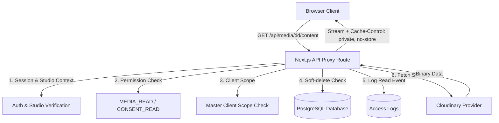

# Requirements

### Overview & Goals
Define the final protected delivery architecture for `CLIENT_CLINICAL_MEDIA` and `CONSENT_DOCUMENT` in the PMU CRM to guarantee immediate revocation, prevent public CDN URL leakage, isolate caches, and fix PDF rendering.

### Scope
- **In Scope**:
  - Architecture evaluation comparing Authenticated Application Proxy (Option A), Signed Provider URLs (Option B), and Cloudinary Private Delivery (Option C).
  - Specification of target revocation semantics, cache headers, error semantics, and access logging.
  - Phase 1.3B implementation contract and test plan.
- **Out of Scope**:
  - Modifying production application code during Phase 1.3A3.
  - Running database schema migrations in Phase 1.3A3.
  - Redesigning Consent V2 signing workflows or Medical Clearance V2.

### Functional Requirements
1. **Zero Raw Provider URL Leakage**: The client browser must only receive internal proxy URLs (`/api/media/[id]/content`) for sensitive media and consents.
2. **Immediate Access Cutoff**: Revoking studio membership, stripping `MEDIA_READ`/`CONSENT_READ`, or setting custom `DENY` policies must immediately prevent fetching media content.
3. **Cache Isolation**: Content responses must emit `Cache-Control: private, no-store` and bypass public Next.js optimizer caching (`unoptimized={true}`).
4. **PDF Consent UX**: Consent PDFs must be viewable inline and downloadable via authenticated routes with correct MIME types.
5. **Access Logging**: Media reads must generate evidentiary access logs in `accessLogs`.

# Technical Design

### Current Implementation
- Sensitive clinical images and consents currently expose raw public Cloudinary URLs (`res.cloudinary.com`).
- Images are rendered via Next.js `<Image>`, causing unauthenticated public caching in `/_next/image` and breaking when rendering PDF consent files.

### Key Decisions
- **Selected Architecture**: **Option A (Authenticated Application Proxy)**.
  - *Rationale*: Guarantees 0-second immediate access revocation, suppresses raw Cloudinary URLs from the browser, enforces strict `private, no-store` headers, and natively supports both clinical images and PDF documents without complex signature synchronization.
- **Schema Impact**: No database migration required for Phase 1.3B; existing schema fields (`id`, `studioId`, `clientId`, `type`, `url`, `publicId`, `deletedAt`) are sufficient.
- **Rendering Mechanism**: `<Image unoptimized src="/api/media/${id}/content" />` for clinical imagery; dedicated PDF viewer/download actions for consent documents.

### Architecture Diagram

### Components and File Structure
- `src/app/api/media/[id]/content/route.ts`: Protected proxy route handler.
- `src/features/media/server/service.ts`: Service methods to resolve media records and mask raw URLs.
- `src/features/media/server/actions.ts`: Server actions returning masked proxy URLs.
- `src/features/media/components/client-media-section.tsx`: UI component rendering images via proxy with `unoptimized` and PDF view/download links.

# Testing

### Validation Approach
Verify protected delivery and security boundaries via automated integration tests in Vitest and end-to-end verification.

### Key Scenarios
1. **Unauthenticated Access**: Verify `GET /api/media/[id]/content` without authentication returns `401 Unauthorized`.
2. **Studio Isolation**: Verify accessing media of another studio returns `404 Not Found`.
3. **Master Scope Validation**: Verify a Master user cannot access clinical media of an unassigned client (`404 Not Found`).
4. **Immediate Revocation**: Verify removing studio membership or permissions immediately denies subsequent content requests (`403 Forbidden`).
5. **Archived Record Suppression**: Verify soft-deleted media (`deletedAt != null`) returns `404 Not Found`.
6. **Header Verification**: Assert `Cache-Control: private, no-store, max-age=0, must-revalidate` and `X-Content-Type-Options: nosniff`.
7. **PDF Delivery**: Verify PDF consent records return `Content-Type: application/pdf` and `Content-Disposition: inline`.
8. **Access Logging**: Verify that successful and denied read requests are written to `accessLogs`.

# Delivery Steps

### ✓ Step 1: Implement Authenticated Media Proxy Route and Service Layer
Implement the server-side streaming proxy endpoint in Next.js and update media retrieval services.

- Create `src/app/api/media/[id]/content/route.ts` implementing `GET` handler with session, studio, permission (`MEDIA_READ`/`CONSENT_READ`), and master client-scoping validation.
- Integrate `sensitiveRead` wrapping in content resolution to log evidentiary reads in `accessLogs`.
- Update `mediaService.getClientMedia` and `getClientMediaAction` to transform raw provider URLs into proxy endpoints (`/api/media/${item.id}/content`) before returning data to the client.
- Configure HTTP response headers (`Cache-Control: private, no-store, max-age=0, must-revalidate`, `X-Content-Type-Options: nosniff`, and accurate `Content-Type`/`Content-Disposition`).

### ✓ Step 2: Update Browser Rendering and PDF Consent Viewers
Update client-side components to safely consume protected URLs and properly render clinical images and consent PDFs.

- Update `ClientMediaSection` in `src/features/media/components/client-media-section.tsx` to use Next.js `<Image ... unoptimized />` for clinical media.
- Add support in `ClientMediaSection` for consent documents, distinguishing image files from PDF documents.
- Implement inline PDF preview links and authenticated download triggers for PDF consent records.

### ✓ Step 3: Add Integration Tests for Protected Delivery and Revocation
Add an end-to-end integration test suite verifying all security boundaries and delivery behaviors.

- Create `tests/integration/protected-media-delivery.test.ts` testing unauthenticated access denial, studio isolation, master client-scope enforcement, and permission revocation.
- Verify `Cache-Control: private, no-store` and `X-Content-Type-Options` headers on proxy responses.
- Assert that `accessLogs` correctly records successful views and denied access attempts.
- Verify that `getClientMediaAction` never returns raw `res.cloudinary.com` URLs to callers.