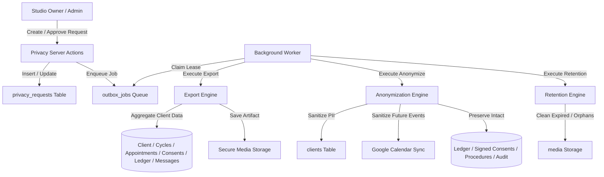

# Requirements

### Overview & Goals
Phase 17 delivers a production-grade Privacy, Data Lifecycle, Export, Retention, and Anonymization subsystem for the CRM. The goal is to provide deterministic data subject request (DSAR) workflows and automated retention policies that maximize data security and privacy while rigorously preserving legally, operationally, and clinically required evidence.

### Scope
- **In Scope**:
  - `privacy_requests` entity model and deterministic state machine (`REQUESTED`, `APPROVED`, `RUNNING`, `COMPLETED`, `FAILED`, `CANCELLED`).
  - Studio-scoped client data export bundle (JSON with manifest, category counts, SHA-256 hashes, excluding secrets/tokens).
  - Secure authenticated export download endpoint with configurable artifact expiration.
  - Client anonymization command replacing direct PII with deterministic placeholders while preserving primary keys and referential integrity.
  - Strict preservation of append-only ledger entries, signed consent evidence/PDF hashes, procedure execution protocols, and audit logs.
  - Media classification and retention policies (temporary upload expiry, export cleanup, safe two-step orphan media deletion).
  - Privacy permissions (`PRIVACY_READ`, `PRIVACY_EXPORT`, `PRIVACY_MANAGE`) with strict role-based access control.
  - Privacy management UI (`/settings/privacy`) and client profile privacy panel with destructive action confirmations.
  - Integration safeguards for AI context assembly, Google Calendar future event synchronization, and search index sanitization.
  - PostgreSQL migration `0038_*.sql` and migration baseline verification.
- **Out of Scope**:
  - Full automated natural-language redaction of free-text message bodies (limitations explicitly documented).
  - Disaster recovery / whole-database backup/restore automation (reserved for subsequent phases).
  - Cross-studio global data migrations.

### User Stories
- **As a Studio Owner/Admin**, I want to export all studio-scoped data for a requesting client in a structured, machine-readable format so that we comply with DSAR obligations.
- **As a Studio Owner**, I want to approve and execute client anonymization so that personal identifiers are scrubbed while preserving historical financial records, signed consent proofs, and procedure integrity.
- **As a Studio Operator**, I want unreferenced orphan media and expired export bundles to be cleaned up automatically in the background without risking clinical or legal evidence.
- **As a Master or Client**, I must not have access to administrative privacy management or anonymization controls.

### Functional Requirements
1. **Privacy Request Tracking**: Support `EXPORT`, `ANONYMIZE`, and `DELETE_WHERE_ALLOWED` requests with full lifecycle auditing.
2. **Deterministic Export**: Generate JSON bundles containing client profile, cycles, appointments, medical revisions, consent metadata, procedures, ledger entries, conversations, messages, and handoffs.
3. **Evidence Preservation Invariants**:
   - Ledger: Append-only integrity strictly preserved; no mutation or deletion of financial records.
   - Consent: Signed consent records, cycle links, timestamps, and PDF evidence hashes remain untouched.
   - Procedures: Clinical session history, protocols, and skin reactions remain coherent.
   - Referential Integrity: Stable `clientId` preserved across all foreign key relationships.
4. **Search Scrubbing**: Anonymized client records must no longer be discoverable by previous names, phone numbers, or emails in search queries.
5. **Safe Media Lifecycle**: Protect active evidence from deletion; clean up unreferenced orphan media and expired export files via background outbox jobs.
6. **Integration Privacy**:
   - AI prompts must use anonymized identity placeholders and never resurrect historical PII.
   - Google Calendar future events must be sanitized to remove client direct PII.

# Technical Design

### Current Implementation
- **Data Access & Scoping**: The application relies on multi-tenant studio scoping via `requireBrowserStudioPermission(...)` and composite foreign keys `(id, studio_id)`.
- **Ledger Invariant**: Financial records (`ledger_entries`) are strictly append-only (charges, payments, refunds, adjustments).
- **Consent & Procedures**: Consents (`cycle_consents`) and procedure sessions (`procedure_sessions`) maintain cryptographic hashes and immutable audit histories.
- **Background Jobs**: Outbox queue (`outbox_jobs`) and worker with transactional leasing (`runWorkerOnce`) handle asynchronous tasks.
- **Migration Baseline**: 38 migrations ending at `0037_awesome_the_anarchist`.

### Key Decisions
1. **Stable Primary Key Anonymization**: When a client is anonymized, the `clients.id` UUID is retained, while direct PII fields (`firstName`, `lastName`, `fullName`, `phone`, `whatsapp`, `email`, `instagram`, `birthDate`, `notes`, `tags`, `referredByName`) are updated with deterministic placeholders.
   *Rationale*: Retaining the primary key avoids cascading deletion or breaking foreign key constraints across append-only ledgers, signed consents, procedure records, and audit logs.
2. **Explicit Two-Step Privacy Request State Machine**: Requests require explicit approval (`REQUESTED` -> `APPROVED` -> `RUNNING` -> `COMPLETED`) before asynchronous execution by the worker.
   *Rationale*: Prevents accidental destructive actions, enforces four-eyes governance where required, and ensures background execution does not block HTTP threads.
3. **Outbox-Driven Background Execution**: Export generation, anonymization execution, and retention cleanup are implemented as transactional handlers registered with `outboxJobs`.
   *Rationale*: Guarantees idempotency, automatic retry on transient failure, and seamless alignment with existing worker infrastructure.
4. **Deterministic Orphan Media Grace Period**: Media cleanup uses a two-phase check (marking/checking for unreferenced media with a grace period of N days) rather than instant deletion.
   *Rationale*: Protects against race conditions with concurrent uploads and ongoing multi-step transactions.

### Architecture Diagram


### Proposed Changes
1. **Schema & Migration**:
   - `src/db/schema.ts`: Define `privacy_requests` and `studio_privacy_retention_policies`.
   - Generate migration `0038_privacy_and_data_lifecycle.sql`.
2. **Permissions & Audit**:
   - `src/lib/permissions.ts`: Add `PRIVACY_READ`, `PRIVACY_EXPORT`, `PRIVACY_MANAGE`.
   - `src/lib/audit-contract.ts`: Add privacy audit actions and access operations.
3. **Core Services**:
   - `src/features/privacy/server/export-service.ts`: Client data export aggregator and JSON packaging.
   - `src/features/privacy/server/anonymization-service.ts`: PII scrubbing and invariant preservation.
   - `src/features/privacy/server/retention-service.ts`: Media classification and orphan cleanup.
   - `src/features/privacy/server/actions.ts`: Server actions for requesting, approving, cancelling, and retrying privacy operations.
4. **API & Downloads**:
   - `src/app/api/privacy/export/[id]/download/route.ts`: Authenticated, permission-checked download route.
5. **Integrations**:
   - `src/features/ai/domain/context-assembler.ts`: Verify PII redaction and sanitized profile consumption.
   - `src/features/google-calendar/server/service.ts`: Update linked future calendar events upon client anonymization.
6. **UI Components**:
   - `src/app/(dashboard)/settings/privacy/page.tsx`: Privacy request management queue.
   - `src/features/privacy/components/client-privacy-panel.tsx`: Client profile privacy actions and history.

### Data Models / Contracts
```typescript
export interface PrivacyRequestRecord {
  id: string;
  studioId: string;
  clientId: string;
  requestType: "EXPORT" | "ANONYMIZE" | "DELETE_WHERE_ALLOWED";
  status: "REQUESTED" | "APPROVED" | "RUNNING" | "COMPLETED" | "FAILED" | "CANCELLED";
  requestedById: string;
  requestedAt: Date;
  approvedById: string | null;
  approvedAt: Date | null;
  startedAt: Date | null;
  completedAt: Date | null;
  failedAt: Date | null;
  failureReason: string | null;
  commandId: string | null;
  exportArtifactId: string | null;
  exportExpiresAt: Date | null;
  createdAt: Date;
  updatedAt: Date;
}

export interface ClientExportBundle {
  manifest: {
    generatedAt: string;
    studioId: string;
    clientId: string;
    schemaVersion: string;
    recordCounts: Record<string, number>;
  };
  client: Record<string, unknown>;
  treatmentCycles: unknown[];
  appointments: unknown[];
  medicalProfileRevisions: unknown[];
  medicalClearances: unknown[];
  consents: unknown[];
  procedures: unknown[];
  ledgerEntries: unknown[];
  conversations: unknown[];
  messages: unknown[];
  handoffs: unknown[];
}
```

### Risks & Mitigations
- **Accidental Evidence Deletion**: Mitigated by strict database constraints, read-only handling of ledger/consents during anonymization, and test suites verifying ledger/consent immutability.
- **Race Condition in Media Cleanup**: Mitigated by checking foreign key linkages and enforcing a multi-day grace period before physical file deletion.
- **PII Leakage in Search or AI**: Mitigated by leveraging Postgres generated columns (`phoneKey`, `nameKey`, `emailKey`) for automatic index updates and adding test assertions on AI context generation.

# Testing

### Validation Approach
Verification will be conducted using automated unit tests, real PostgreSQL integration tests, concurrency race condition tests, and migration integrity verifiers.

### Key Scenarios
1. **Privacy Request Lifecycle**:
   - Create export request as `ADMIN` -> Approve as `OWNER` -> Worker executes -> Status becomes `COMPLETED` -> Export artifact created with expiration date.
   - Reject/Cancel request -> Status becomes `CANCELLED` -> Worker skips execution.
2. **Client Data Export**:
   - Verify export bundle contains all studio-scoped records for the client (profile, cycles, appointments, medical, consents, procedures, ledger, messages).
   - Verify exclusion of staff secrets, OAuth credentials, and other clients' data.
   - Verify authenticated download succeeds for `OWNER`/`ADMIN` and rejects unauthorized users or expired links.
3. **Client Anonymization**:
   - Verify direct PII fields are replaced with placeholders (`Anonymized Client`, etc.).
   - Verify stable `clientId` is preserved and client searches by old phone/email return empty results.
   - Verify append-only ledger entries, signed consent PDFs, and procedure clinical records remain 100% intact.
4. **Media Retention & Cleanup**:
   - Verify unreferenced orphan media older than the grace period is deleted.
   - Verify active consent PDFs, procedure photos, and newly created media are strictly protected from cleanup.
5. **Integration Invariants**:
   - Verify AI prompt assembler uses anonymized name and sanitized medical history.
   - Verify Google Calendar sync updates future events to anonymized summaries.

### Edge Cases & Concurrency
- Duplicate anonymization command execution is idempotent and safe.
- Concurrent client profile update and anonymization resolve deterministically without corrupting state.
- Concurrent media upload and retention cleanup do not delete in-flight uploads.
- Real PostgreSQL concurrency verified via `npm run test:postgres`.

### Test Suite Additions
- `tests/unit/privacy-export.test.ts`: Export bundle aggregation, manifest validation, secret scrubbing.
- `tests/unit/privacy-anonymization.test.ts`: PII replacement rules, search index key verification.
- `tests/integration/privacy-lifecycle.test.ts`: Request state machine, permissions, download route.
- `tests/integration/media-retention.test.ts`: Orphan detection, evidence protection, grace period logic.
- `tests/integration/privacy-concurrency.test.ts`: Real PostgreSQL race condition testing.

# Delivery Steps

### ✓ Step 1: Database Schema, Permissions & Privacy Core
Define the database schema, migration baseline, role-based permission capabilities, and audit contracts for privacy management.

- Add `privacy_requests` table in `src/db/schema.ts` with columns: `id`, `studio_id`, `client_id`, `request_type`, `status`, `requested_by_id`, `requested_at`, `approved_by_id`, `approved_at`, `started_at`, `completed_at`, `failed_at`, `failure_reason`, `command_id`, `export_artifact_id`, `export_expires_at`, `created_at`, `updated_at`, along with composite foreign keys to `studios` and `clients`, and check constraints for request types (`EXPORT`, `ANONYMIZE`, `DELETE_WHERE_ALLOWED`) and statuses (`REQUESTED`, `APPROVED`, `RUNNING`, `COMPLETED`, `FAILED`, `CANCELLED`).
- Add studio retention policy fields in `src/db/schema.ts` for configuring temporary upload expiration, export artifact retention, and orphan media grace period.
- Register privacy permissions in `src/lib/permissions.ts` (`PRIVACY_READ`, `PRIVACY_EXPORT`, `PRIVACY_MANAGE`) and bind them to `ROLE_CAPABILITIES` (granting `OWNER` full capability, `ADMIN` operational management, and strictly excluding `MASTER`, `CLIENT`, and `AI_SYSTEM`).
- Extend audit and access contracts in `src/lib/audit-contract.ts` with privacy actions (`privacy_request_created`, `privacy_request_approved`, `privacy_request_cancelled`, `privacy_export_generated`, `privacy_export_downloaded`, `privacy_anonymization_started`, `privacy_anonymization_completed`, `retention_cleanup_executed`) and operations (`privacy.requests.list`, `privacy.request.read`, `privacy.export.download`).
- Generate canonical migration `0038_*.sql`, update `drizzle/meta/_journal.json` and snapshots, and update `tests/phase02-pg-verify.mjs` and `tests/migrations.test.mjs`.

### ✓ Step 2: Client Data Export Engine & Secure Download
Implement deterministic, studio-isolated client data export bundling and authenticated download capabilities.

- Create `src/features/privacy/server/export-service.ts` to aggregate studio-scoped client data including client profile, treatment cycles, appointments, medical profile revisions, clearance history, cycle consent records/evidence hashes, procedure histories, append-only ledger entries, conversations, messages, handoffs, and automation jobs.
- Enforce strict exclusion of staff secrets, OAuth credentials, third-party tokens, and other studio/client records.
- Generate a machine-readable JSON export bundle containing `generatedAt`, `studioId`, `clientId`, schema version, category record counts, and media evidence manifests with SHA-256 integrity checksums.
- Store the generated export bundle securely with an explicit expiration timestamp (`export_expires_at`).
- Implement secure download route `/api/privacy/export/[id]/download` verifying authenticated studio context, `PRIVACY_EXPORT` capability, and non-expired artifact status, with audit access logging.

### ✓ Step 3: Client Anonymization Engine & Integrations
Implement the client anonymization command while strictly preserving referential integrity and legal/clinical evidence.

- Create `src/features/privacy/server/anonymization-service.ts` implementing `anonymizeClient(...)` inside an idempotent transaction.
- Replace direct identifying client attributes (`firstName`, `lastName`, `fullName`, `phone`, `whatsapp`, `email`, `instagram`, `birthDate`, `notes`, `tags`, `referredByName`) with deterministic non-identifying placeholders, automatically updating Postgres generated index keys (`phoneKey`, `emailKey`, `nameKey`, `instagramKey`, `whatsappKey`).
- Preserve the stable `clientId` primary key and all historical relationships with appointments, treatment cycles, consent records, procedure sessions, messages, and audit trails.
- Enforce strict preservation of the append-only ledger without modifying or deleting financial transactions, refunds, charges, or adjustments.
- Retain signed consent records, PDF evidence hashes, and procedure clinical data without mutating historical bytes or timestamps.
- Update `ContextRedactor` in `src/features/ai/domain/context-assembler.ts` to ensure AI prompts do not resurrect previous identity attributes from history.
- Synchronize linked future Google Calendar events to replace client PII with anonymized placeholders while preserving event mappings.

### ✓ Step 4: Media Retention & Safe Orphan Cleanup
Implement media classification, retention policy enforcement, and deterministic orphan cleanup.

- Create `src/features/privacy/server/retention-service.ts` to enforce lifecycle policies for temporary uploads, expired export artifacts, and orphan media.
- Classify media into authoritative evidence (consent PDFs, procedure execution photos), client general media, temporary unfinalized uploads, generated export bundles, and orphans.
- Implement two-stage orphan detection: identify unreferenced media records, verify absence of active foreign key linkages, and apply a configurable grace period before deletion.
- Guard signed consent documents and procedure evidence against deletion during generic cleanup runs.
- Register transactional cleanup handlers in the outbox worker (`src/server/events/worker.ts`) for asynchronous background execution.

### ✓ Step 5: Privacy UI, Client Controls & Acceptance Gates
Build the operator privacy management interface, client profile privacy panel, and validate complete quality gates.

- Implement `/settings/privacy` page for reviewing, approving, executing, and retrying privacy requests with role-gated action controls.
- Add a Privacy & Data Lifecycle panel to the client profile page (`src/app/(dashboard)/clients/[id]/page.tsx`) with high-friction destructive confirmation for anonymization requests.
- Add comprehensive unit, integration, and PostgreSQL concurrency test suites covering export bundling, anonymization invariants, ledger immutability, orphan cleanup safety, permission enforcement, and background execution.
- Run the full suite of quality gates (`npm run typecheck`, `npm run lint`, `npm run test:migrations`, `npm run test:unit`, `npm run test:regressions`, `npm run test:integration`, `npm run test:postgres`, `npm test`, `npm run build:test`, `node --test tests/phase02-pg-verify.mjs`).